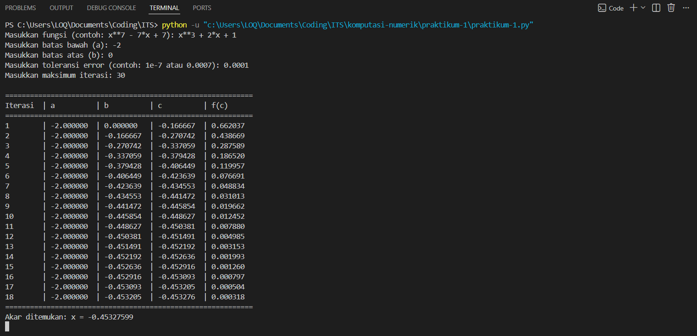
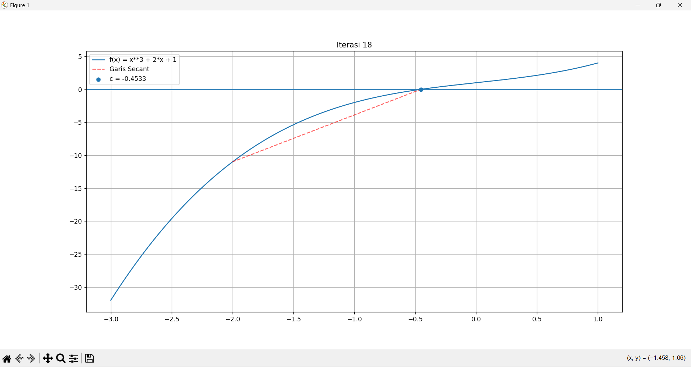

 <div align="center">

# Praktikum 1 (Regula Falsi)

| NRP | Nama |
| :---: | :---: |
| 5025251028 | Julianda Caesar Prakoso |
| 5025251046 | Muhammad Fairuz Ananta |
| 5025251052 | Hilmy Fausta Pratama |

## Laporan Praktikum 1

</div>

## Langkah-langkah & Potongan Kode

**1. Membuat file Python**

Buat file Python dengan nama `praktikum-1.py` menggunakan terminal.

```bash
type nul > praktikum-1.py
```

**2. Membuka dan mengedit file Python**

Buka file Python menggunakan Visual Studio Code.

```bash
code praktikum-1.py
```

**3. Mengimpor library**

Import library NumPy untuk operasi numerik, Matplotlib untuk visualisasi grafik fungsi, serta SymPy untuk mengubah input fungsi dalam bentuk string menjadi ekspresi matematika.

```py
import numpy as np
import matplotlib.pyplot as plt
from sympy import sympify, symbols, lambdify
```

**4. Mendefinisikan fungsi utama**

Definisikan fungsi `regula_falsi_method()` yang berisi seluruh proses penyelesaian persamaan menggunakan metode Regula Falsi.

```py
def regula_falsi_method():
```

**5. Memasukkan data**

Meminta pengguna memasukkan fungsi matematika, batas bawah, batas atas, toleransi error, dan maksimum iterasi.

```py
function_input = input("Masukkan fungsi (contoh: x**7 - 7*x + 7): ")
lower_bound = float(input("Masukkan batas bawah (a): "))
upper_bound = float(input("Masukkan batas atas (b): "))
tolerance = float(input("Masukkan toleransi error (contoh: 1e-7 atau 0.0007): "))
max_iterations = int(input("Masukkan maksimum iterasi: "))
```

**6. Mengonversi input menjadi fungsi matematika**

Menggunakan SymPy untuk mengonversi ekspresi matematika yang dimasukkan pengguna menjadi fungsi yang dapat dievaluasi secara numerik menggunakan NumPy.

```py
x = symbols('x')
expression = sympify(function_input)
function = lambdify(x, expression, 'numpy')
```

**7. Memvalidasi interval**

Memeriksa apakah interval yang dimasukkan memenuhi syarat metode Regula Falsi, yaitu nilai fungsi pada kedua batas interval harus memiliki tanda yang berbeda (\(f(a) \cdot f(b) < 0\)).

```py
if function(lower_bound) * function(upper_bound) >= 0:
    print("Metode gagal: Tidak ada perubahan tanda di interval tersebut.")
    return
```

**8. Membuat header tabel iterasi**

Menampilkan header tabel untuk mencatat hasil setiap iterasi, meliputi nomor iterasi, batas bawah, batas atas, nilai pendekatan akar, dan nilai fungsi pada pendekatan akar.

```py
print("\n" + "=" * 60)
print(f"{'Iterasi':<8} | {'a':<10} | {'b':<10} | {'c':<10} | {'f(c)':<10}")
print("=" * 60)
```

**9. Menginisialisasi grafik**

Mengaktifkan mode interaktif Matplotlib dan membuat area grafik dengan ukuran 10 × 6. Selanjutnya, menentukan rentang nilai x dan menghitung nilai fungsi untuk visualisasi grafik.

```py
plt.ion()
fig, ax = plt.subplots(figsize=(10, 6))

x_values = np.linspace(lower_bound - 1, upper_bound + 1, 400)
y_values = function(x_values)
```

**10. Menginisialisasi nilai pendekatan sebelumnya**

Menginisialisasi `previous_c` dengan nilai batas bawah sebagai nilai pendekatan awal untuk membandingkan perubahan nilai akar pada setiap iterasi.

```py
previous_c = lower_bound
```

**11. Memulai proses iterasi**

Melakukan perulangan berdasarkan jumlah maksimum iterasi yang telah dimasukkan pengguna.

```py
for iteration in range(1, max_iterations + 1):
```

**12. Menghitung nilai pendekatan akar menggunakan metode Regula Falsi**

Menghitung nilai fungsi pada batas bawah dan batas atas, kemudian menentukan pendekatan akar menggunakan rumus Regula Falsi.

```py
f_lower = function(lower_bound)
f_upper = function(upper_bound)

# Calculate the Regula Falsi approximation
c = (lower_bound * f_upper - upper_bound * f_lower) / (f_upper - f_lower)
f_c = function(c)
```

**13. Menampilkan hasil iterasi**

Menampilkan hasil perhitungan setiap iterasi dalam bentuk tabel agar perubahan nilai batas interval dan pendekatan akar dapat diamati.

```py
print(f"{iteration:<8} | {lower_bound:<10.6f} | {upper_bound:<10.6f} | {c:<10.6f} | {f_c:<10.6f}")
```

**14. Memperbarui visualisasi grafik**

Membersihkan grafik sebelumnya, menggambar kembali kurva fungsi, menampilkan garis horizontal pada \(y = 0\), menggambar garis secant, dan menandai titik pendekatan akar.

```py
ax.clear()
ax.plot(x_values, y_values, label=f'f(x) = {function_input}')
ax.axhline(0)

# Draw secant line
ax.plot([lower_bound, upper_bound], [f_lower, f_upper], 'r--', alpha=0.6, label="Garis Secant")

# Mark root approximation
ax.scatter(c, f_c, label=f'c = {c:.4f}', zorder=5)
```

**15. Mengatur tampilan grafik**

Menambahkan judul berdasarkan nomor iterasi, legenda, dan grid agar grafik lebih mudah dibaca.

```py
ax.set_title(f"Iterasi {iteration}")
ax.legend()
ax.grid()
```

**16. Memperbarui tampilan grafik**

Memperbarui grafik secara interaktif dan memberikan jeda selama 0,8 detik agar perubahan setiap iterasi dapat diamati.

```py
plt.draw()
plt.pause(0.8)
```

**17. Memeriksa kondisi berhenti**

Menghentikan iterasi apabila nilai absolut fungsi pada pendekatan akar lebih kecil dari toleransi atau perubahan nilai pendekatan akar antariterasi lebih kecil dari toleransi.

```py
if abs(f_c) < tolerance or abs(c - previous_c) < tolerance:
    print("=" * 60)
    print(f"Akar ditemukan: x = {c:.8f}")
    break
```

**18. Memperbarui nilai pendekatan dan interval**

Menyimpan nilai pendekatan akar saat ini sebagai referensi untuk iterasi berikutnya. Selanjutnya, memperbarui batas interval berdasarkan perubahan tanda fungsi.

```py
previous_c = c

# Update interval boundaries
if f_lower * f_c < 0:
    upper_bound = c
else:
    lower_bound = c
```

**19. Menampilkan grafik akhir**

Menonaktifkan mode interaktif Matplotlib dan menampilkan grafik akhir setelah proses iterasi selesai.

```py
plt.ioff()
plt.show()
```

**20. Memanggil program utama**

Menggunakan kondisi `if __name__ == "__main__":` untuk memastikan fungsi `regula_falsi_method()` dijalankan ketika file dieksekusi secara langsung.

```py
if __name__ == "__main__":
    regula_falsi_method()
```

## Tampilan

### Input & Output



### Grafik

