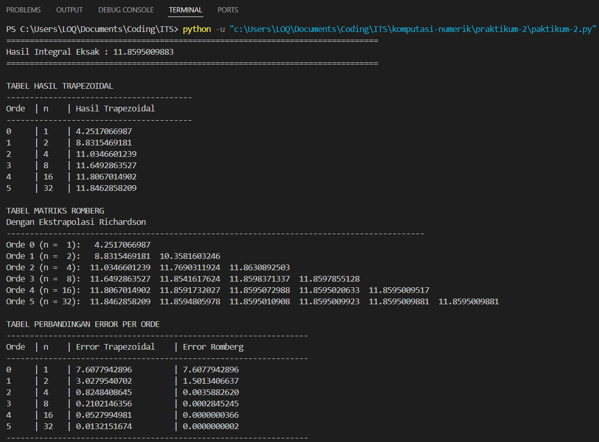
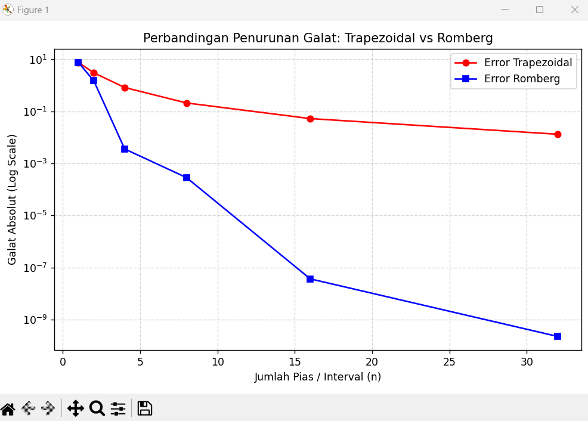

<div align="center">

# Praktikum 2 (Integrasi Romberg)

| NRP | Nama |
| :---: | :---: |
| 5025251028 | Julianda Caesar Prakoso |
| 5025251046 | Muhammad Fairuz Ananta |
| 5025251052 | Hilmy Fausta Pratama |

## Laporan Praktikum 2

</div>

## Langkah-langkah & Potongan Kode

**1. Membuat file Python**

Buat file Python dengan nama `praktikum-2.py` menggunakan terminal.

```bash
touch praktikum-2.py
```

**2. Membuka dan mengedit file Python**

Buka file Python menggunakan Visual Studio Code.

```bash
code praktikum-2.py
```

**3. Mengimpor library**

Import library NumPy untuk komputasi numerik, Matplotlib untuk visualisasi grafik, dan SciPy untuk menghitung nilai integral eksak menggunakan fungsi `quad()`.

```py
import numpy as np
import matplotlib.pyplot as plt
from scipy.integrate import quad
```

**4. Mendefinisikan fungsi yang akan diintegralkan**

Definisikan fungsi matematika yang akan dihitung nilai integralnya, yaitu \(f(x) = e^x \sin(x)\).

```py
# Function to be integrated
def f(x):
    return np.exp(x) * np.sin(x)
```

**5. Membuat fungsi Trapezoidal Rule**

Membuat fungsi `trapezoidal()` untuk menghitung pendekatan integral numerik menggunakan metode Trapezoidal. Interval dibagi menjadi sejumlah pias berdasarkan parameter `n`, kemudian luas setiap pias dijumlahkan menggunakan aturan trapesium.

```py
# Trapezoidal rule
def trapezoidal(f, a, b, n):
    h = (b - a) / n
    total = 0.5 * (f(a) + f(b))

    for i in range(1, n):
        total += f(a + i * h)

    return total * h
```

**6. Membuat fungsi Integrasi Romberg**

Membuat fungsi `romberg()` untuk menghitung integral menggunakan metode Romberg. Proses dimulai dengan menghitung pendekatan integral menggunakan metode Trapezoidal dengan jumlah interval \(2^i\), kemudian meningkatkan akurasi menggunakan Ekstrapolasi Richardson.

```py
# Romberg integration
def romberg(f, a, b, max_level):
    R = np.zeros((max_level, max_level))

    # R(i, 0) = Trapezoidal rule with 2^i intervals
    for i in range(max_level):
        n = 2**i
        R[i, 0] = trapezoidal(f, a, b, n)

    # Richardson extrapolation
    for j in range(1, max_level):
        for i in range(j, max_level):
            R[i, j] = R[i, j - 1] + (R[i, j - 1] - R[i - 1, j - 1]) / (4**j - 1)

    return R
```

**7. Mendefinisikan fungsi utama dan parameter integral**

Membuat fungsi `main()` sebagai tempat menjalankan seluruh proses perhitungan. Menentukan batas bawah integral, batas atas integral, dan maksimum level Romberg yang digunakan.

```py
def main():
    a = 0.0
    b = 3.0
    max_level = 6
```

**8. Menghitung nilai integral eksak**

Menggunakan fungsi `quad()` dari SciPy untuk memperoleh nilai integral dengan akurasi tinggi sebagai acuan dalam membandingkan hasil pendekatan numerik.

```py
# Calculate the exact integral value
exact_value, _ = quad(f, a, b)
```

**9. Membuat tabel Romberg**

Memanggil fungsi `romberg()` untuk menghasilkan matriks Romberg berdasarkan batas integral dan maksimum level yang telah ditentukan.

```py
# Romberg table calculation
R = romberg(f, a, b, max_level)
```

**10. Menghitung galat absolut**

Menghitung galat absolut dari metode Trapezoidal dan Romberg dengan membandingkan hasil pendekatan numerik terhadap nilai integral eksak. Selanjutnya, menentukan jumlah interval pada setiap level menggunakan \(2^i\).

```py
# Calculate errors
trapezoidal_error = [abs(R[i, 0] - exact_value) for i in range(max_level)]
romberg_error = [abs(R[i, i] - exact_value) for i in range(max_level)]

interval_count = [2**i for i in range(max_level)]
```

**11. Menampilkan hasil perhitungan**

Menampilkan nilai integral eksak, tabel hasil Trapezoidal, matriks Romberg dengan Ekstrapolasi Richardson, serta tabel perbandingan galat absolut dari kedua metode.

```py
# Display exact integral value
print("=" * 80)
print(f"Hasil Integral Eksak : {exact_value:.10f}")
print("=" * 80)

# Trapezoidal table
print("\nTABEL HASIL TRAPEZOIDAL")
print("-" * 40)
print(f"{'Orde':<5} | {'n':<4} | {'Hasil Trapezoidal'}")
print("-" * 40)

for i in range(max_level):
    print(f"{i:<5} | {interval_count[i]:<4} | {R[i, 0]:.10f}")

# Romberg table
print("\nTABEL MATRIKS ROMBERG")
print("Dengan Ekstrapolasi Richardson")
print("-" * 90)

for i in range(max_level):
    row = f"Orde {i} (n = {interval_count[i]:2}): "

    for j in range(i + 1):
        row += f"{R[i, j]:14.10f} "

    print(row)

# Error comparison table
print("\nTABEL PERBANDINGAN ERROR PER ORDE")
print("-" * 65)
print(f"{'Orde':<5} | {'n':<4} | {'Error Trapezoidal':<20} | {'Error Romberg'}")
print("-" * 65)

for i in range(max_level):
    print(f"{i:<5} | {interval_count[i]:<4} | {trapezoidal_error[i]:<20.10f} | {romberg_error[i]:.10f}")

print("-" * 65)
```

**12. Memvisualisasikan perbandingan galat**

Membuat grafik perbandingan galat absolut metode Trapezoidal dan Romberg berdasarkan jumlah interval. Menggunakan skala logaritmik pada sumbu Y agar perubahan galat dapat diamati dengan lebih jelas.

```py
# Error comparison graph
plt.figure(figsize=(8, 5))

plt.plot(interval_count, trapezoidal_error, marker='o', linestyle='-', color='red', label='Error Trapezoidal')
plt.plot(interval_count, romberg_error, marker='s', linestyle='-', color='blue', label='Error Romberg')

plt.yscale('log')
plt.xlabel('Jumlah Pias / Interval (n)')
plt.ylabel('Galat Absolut (Log Scale)')
plt.title('Perbandingan Penurunan Galat: Trapezoidal vs Romberg')
plt.grid(True, which='both', linestyle='--', alpha=0.5)
plt.legend()
plt.tight_layout()
plt.show()
```

**13. Memanggil program utama**

Menggunakan kondisi `if __name__ == "__main__":` untuk memastikan fungsi `main()` dijalankan ketika file dieksekusi secara langsung.

```py
if __name__ == "__main__":
    main()
```

## Tampilan

### Output



### Grafik

